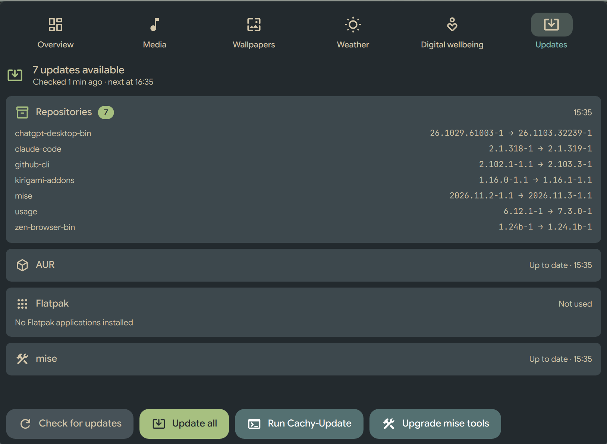

# Arch Updates for DMS

A [Dux Shell (DMS)](https://duxlabs.dev/docs/dms/) plugin for Arch Linux and Arch-based systems
such as CachyOS. It shows available updates from the repositories, the AUR, Flatpak and
[mise](https://mise.jdx.dev), and runs them in a terminal:

- system updates go through **Arch-Update** (or **Cachy-Update**, its CachyOS fork) when it is
  installed, keeping its Arch news, pacnew, orphan, cache and reboot steps; otherwise, or if you
  prefer, directly through your AUR helper or pacman (see [System update method](#system-update-method));
- mise tools go through **`mise upgrade --global`**, which stays within the versions requested
  in `~/.config/mise/config.toml`.

Updates open in your terminal, chosen the same way DMS chooses it (see [Terminal](#terminal)).

The plugin only checks, displays and launches. It never runs an update on its own.

This is a community plugin, not affiliated with Arch Linux or CachyOS.



## Surfaces

| Surface | Behaviour |
| --- | --- |
| Bar pill | Icon and update count. Hidden, taking no space, when there is nothing to update. Background checks never make it appear or flash. Click: popout. Right click: dashboard tab. The icon turns to the warning color if some check failed. |
| Popout | Sources with updates or problems, a re-check button, and *Update all* / *System* / *mise*. |
| Dashboard tab *Updates* | Every source with its status, last check time, errors and warnings; *Check for updates*, the same update actions, and *Bump mise versions…* when upgrades exist past the configured versions. Available while the pill is hidden: `dms ipc call dash open plugin_archUpdates`. |
| Settings | Settings → Plugins → Arch Updates: system update method, check interval, timeout, terminal override, mise options. |

## How checking works

A daemon component owns all state: one instance per shell, whatever the number of bars or
screens, and it keeps running while no view is open. The bar pills, popout and dashboard tab
only read it.

Each source is checked by [`scripts/check.sh`](scripts/check.sh), which reports success,
"not applicable" or failure explicitly. Checks are the same whichever update method is used:

| Source | Command | Follows |
| --- | --- | --- |
| Repositories | `checkupdates`, with a private sync database in `$XDG_RUNTIME_DIR/dms-arch-updates/` | pacman's `IgnorePkg` |
| AUR | `<helper> -Qua` | `NoAUR` and `AURHelper` in `~/.config/arch-update/arch-update.conf`, otherwise paru, yay, then pikaur (as Arch-Update) |
| Flatpak | `flatpak remote-ls --updates`, for the user and system installations that have something installed | `NoFlatpak`, `flatpak mask` patterns |
| mise | `mise outdated --global --json` (and `--bump` for the dashboard-only list) | versions requested in the global config |

`arch-update.conf` is optional: without it the defaults above apply, with or without Arch-Update
installed.

- All sources run in parallel, each under `timeout`, and results are applied together when the
  round ends. A second check never starts while one runs.
- A failed source keeps its previous results, marked as failed with the time of the last
  success. A failure is never shown as "up to date". If mise reports tools it could not check,
  the source is marked incomplete.
- Results are cached in DMS's plugin state, so after a shell restart the pill shows the last
  known count at once. The next check runs when the interval is due (at the earliest 45 s after
  startup). Failed rounds are retried after 5, 10, 20… minutes, capped at the interval.
- Upgrades past the configured mise versions are listed in the dashboard only and are not
  counted, so pinned tools never keep the pill visible.

## Running updates

Update actions open `<terminal> env bash scripts/run-update.sh <mode> [method]` through
`systemd-run --user --scope`, so the terminal lives in its own cgroup: reloading or restarting
DMS does not interrupt a transaction. The tools keep their normal output and prompts.

| Mode | Runs |
| --- | --- |
| `system` | the system update (see below) |
| `mise` | `mise upgrade --global` |
| `all` | the system update, then `mise upgrade --global` |
| `mise-bump` | `mise upgrade --global --bump --interactive` (choose tools; rewrites their requested versions) |

The script tells the daemon when it starts and ends (`dms ipc call archUpdates started|finished`),
including when the window is closed, and the daemon then checks again.

### System update method

Settings → Plugins → Arch Updates → *System update method*:

| Method | Runs |
| --- | --- |
| **Automatic** (default) | Arch-Update / Cachy-Update when installed, otherwise *Direct* |
| **Arch-Update / Cachy-Update** | `cachy-update` if installed, otherwise `arch-update`. Besides repositories, AUR and Flatpak, it shows Arch news and handles pacnew files, orphan packages, the package cache and reboot notices. Greyed out on the settings page when neither is installed. |
| **Direct** | `<helper> -Syu` with paru, yay or pikaur (repositories, then AUR, in one run), or `sudo pacman -Syu` when there is no helper or `NoAUR` is set; then `flatpak update` when Flatpak is in use. No news or maintenance steps. |

The buttons name the command they run (*Run Cachy-Update*, *Run yay -Syu*…). If the chosen tool
is uninstalled later, updates fall back to *Direct* and the settings page says so.

### Terminal

With the plugin's *Terminal command* setting left empty (the default), the terminal is, in order:

1. DMS's own terminal setting (the one DMS uses for `Terminal=true` applications);
2. `$TERMINAL`;
3. the first installed of `xdg-terminal-exec`, ghostty, kitty, foot, alacritty, wezterm,
   konsole, gnome-terminal, ptyxis, xfce4-terminal, xterm.

A configured terminal that is not installed is skipped (and reported). The plugin adds the
right "run this command" arguments for known terminals (`-e` for Ghostty, Alacritty, Konsole,
xterm; nothing for kitty and foot; `start --` for WezTerm; `--` for GNOME Terminal and Ptyxis;
`-x` for xfce4-terminal and Terminator; `-e` for anything else). The settings page shows which
terminal is used and why; the dashboard and popout only mention it when none was found.

Setting *Terminal command* overrides all of this with a literal prefix, for a terminal the
table does not know or to add flags, e.g. `kitty --hold` or `ghostty --title=Updates -e`.

## Why mise, and only mise

Besides the system's own sources, the plugin follows exactly one tool manager, on purpose.
It started as the plugin for my own development machine, where [mise](https://mise.jdx.dev)
already gathers what would otherwise be separate update sources: language runtimes and CLI tools
from npm, cargo, pipx, GitHub releases and more, each pinned or tracked in one config, with
per-directory development environments on top. Following mise covers all of them through a single,
well-proven tool, instead of adding one source per ecosystem to the plugin.

mise checks can be turned off in the settings; the system part works the same without mise.

## IPC

```sh
dms ipc call archUpdates check            # start a check
dms ipc call archUpdates status           # JSON summary, including the update method and terminal
dms ipc call archUpdates update all       # or system, mise, mise-bump
dms ipc call dash open plugin_archUpdates # open the dashboard tab
```

## Install

Requirements: DMS ≥ 2.1, `pacman-contrib` (checkupdates), a terminal (see [Terminal](#terminal)),
systemd user session. Optional: Arch-Update (`arch-update` from the AUR) or Cachy-Update
(`cachy-update` on CachyOS), an AUR helper (paru, yay or pikaur), Flatpak, mise.

```sh
git clone https://github.com/hbouttev/dms-arch-updates.git ~/src/dms-arch-updates
ln -s ~/src/dms-arch-updates ~/.config/dms/plugins/archUpdates
dms ipc call plugin-scan scan
dms ipc call plugins enable archUpdates
```

Then add *Arch Updates* to a bar in Settings → Bar (or add `{"id": "archUpdates", "enabled": true}`
to a bar's widget list in `~/.config/dms/settings.json`).

### Coexistence with other updaters

The plugin does not touch Arch-Update's own checker or tray applet, and never writes its state
files. Both are optional: `arch-update` / `cachy-update` work without them.

- `arch-update.timer` runs scheduled checks with desktop notifications. If
  `systemctl --user is-enabled arch-update.timer` says it is enabled,
  `systemctl --user disable --now arch-update.timer` stops it.
- The tray applet may start at every login: the `cachy-update` package installs
  `/etc/xdg/autostart/arch-update-tray.desktop` for all users, and `arch-update --tray --enable`
  creates a per-user entry. It only shows Arch-Update's last results, so next to the plugin it is a
  second, possibly stale, update icon. To turn it off without editing a packaged file (pacman
  would restore it), make the per-user entry one that marks it hidden, then stop the running copy:

  ```sh
  mkdir -p ~/.config/autostart
  printf '[Desktop Entry]\nHidden=true\n' > ~/.config/autostart/arch-update-tray.desktop
  systemctl --user stop 'app-arch\x2dupdate\x2dtray@autostart.service'
  ```

## Development

```text
plugin.json              manifest (composite: daemon + bar widget + dash tab)
UpdatesDaemon.qml        scheduling, checks, state, persistence, IPC, launching
UpdatesWidget.qml        bar pill and popout
UpdatesTab.qml           dashboard tab
UpdatesPanel.qml         the view shared by the popout (compact) and the tab
SourceSection.qml        one source card; UpdateRow.qml: one update line
CheckProcess.qml         Process wrapper that reports exit code, stdout and stderr together
UpdatesSettings.qml      settings page; UpdateMethodSetting.qml: the update method choice
UpdateTexts.qml          all wording built from codes and values (translatable)
logic/Updates.js         parsing, state merging, terminal and update method choice (pure functions)
scripts/common.sh        arch-update.conf options, AUR helper and Arch-Update detection, coded messages
scripts/check.sh         per-source checks
scripts/detect.sh        installed update tools, as JSON for the daemon
scripts/run-update.sh    update runner in the terminal
tests/run.mjs            tests for logic/Updates.js and the message codes
assets/screenshot.png    screenshot for the README and the plugin registry
```

```sh
node tests/run.mjs                            # logic tests, and message codes vs UpdateTexts.qml
scripts/check.sh aur; echo $?                 # one source by hand (0 ok, 3 n/a, else failure)
scripts/detect.sh                             # update tools found
dms ipc call plugins reload archUpdates       # reload after editing a component (see below)
journalctl --user -u dms -f | grep archUpdates  # logs
```

`dms ipc call plugins reload` only picks up changes to the component files named in
`plugin.json`. Qt caches everything else until the shell restarts: the shared views
(`UpdatesPanel.qml`, `SourceSection.qml`, `UpdateRow.qml`, `CheckProcess.qml`,
`UpdateMethodSetting.qml`, `UpdateTexts.qml`), the `.pragma library` script `logic/Updates.js`,
and the list of files in the plugin folder. After editing those, or adding a file, run
`dms restart`.

### Translations

The plugin is ready for translation but ships none yet. Every string it shows goes through
`I18n.trFor("archUpdates", "…")` in a QML file, which is what DMS's translation tooling extracts.

- `logic/Updates.js` holds no wording: it returns codes and values (for example
  `{unit: "minutes", value: 5}`), and `UpdateTexts.qml` turns them into text.
- Messages from the check scripts are printed as `code<TAB>English text[<TAB>argument…]` (see
  `coded` in `scripts/common.sh`), so the scripts stay readable on their own. `UpdateTexts.qml`
  translates known codes and shows the English text for any other. `tests/run.mjs` fails if a
  code has no case there.
- Error output from pacman, the AUR helper, Flatpak and mise is shown as the tool printed it.
  The terminal update script (`run-update.sh`) is not part of the DMS interface and stays English.

A translation is a `translations/<locale>.json` file (`fr.json`, `pt_BR.json`…) mapping each
English string to its translation, as described in DMS's plugin guide.
